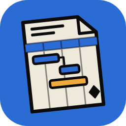

<p align="center">
  
</p>

<h1 align="center">PlanCraft</h1>

<p align="center"><b>Local-first project planning in Rust, in the spirit of MS Project.</b></p>

PlanCraft is a standalone project planner for any kind of project: schedules, Gantt charts,
resources, agile backlogs and project documents. It runs on your own devices and keeps each
project in a shared folder (synced with Syncthing or similar), so the same project can be edited
from several devices, offline, and the changes merge. An optional link to RevuCraft brings punch
items from drawings into the plan.

It is built on [GridCraft](https://github.com/storytold/gridcraft), the open-source Rust
spreadsheet by the ArtCraft team, and keeps GridCraft's engine, command system, CLI and MCP server.

## Status

**Phase 1 (project files and sync).** Projects, their tasks, links, resources and calendar are
stored in a `.plan` folder that several devices can edit offline and merge (Loro CRDT, one change
file per device). The desktop window is still GridCraft's spreadsheet; until the project views
arrive (Phase 3), projects are created and edited with `plancraft-cli project`. The scheduler
comes in Phase 2.
The full plan, decisions and phases are in [`PLAN.md`](PLAN.md); the RevuCraft integration notes
are in [`docs/revucraft-integration.md`](docs/revucraft-integration.md).

## Download

Windows builds are on the [Releases](https://github.com/Azurehawke/plancraft/releases) page:
`plancraft-<version>-windows-x64.msi` (installer) or `…-portable.zip` (no install). They aren't
code-signed yet, so SmartScreen may ask: choose **More info**, then **Run anyway**. The app checks
this repository for updates.

## Try a project on two devices

With PlanCraft installed on two Windows devices that share a folder through Syncthing (the CLI is
`plancraft-cli.exe`, next to `plancraft.exe` in the install folder (`Program Files\ArtCraft\PlanCraft`, or `%LOCALAPPDATA%\Programs\ArtCraft\PlanCraft` for a per-user install) or the portable zip):

```powershell
plancraft-cli project new M:\Jobs "Test Job"                  # on the laptop
plancraft-cli project add "M:\Jobs\Test Job.plan" Survey
plancraft-cli project add "M:\Jobs\Test Job.plan" "Walk the site" --under 1 --duration 4h
plancraft-cli project show "M:\Jobs\Test Job.plan"
```

Then, with either device offline, edit on both (`project set`, `add`, `move`, `link`…), let
Syncthing sync, and run `project show` on each: both show the same merged project.
`plancraft-cli project help` lists every command; `project devices` shows each device's file.

## Build

```sh
cargo run --release -p plancraft            # desktop app
cargo run --release -p plancraft-cli -- --help
cargo xtask ci                              # fmt, clippy, tests, assets, layering, wasm
```

Windows installer: `pwsh packaging/windows/package.ps1 -Arch x64` (needs WiX 5), or let
`.github/workflows/plancraft-windows.yml` build it: every push builds it, and a `v*` tag publishes
a release.

## Relationship to GridCraft

- `storytold/gridcraft` is the `upstream` remote; its updates are merged by hand.
- GridCraft's crates (`crates/*`, named `gridcraft-*`) are kept as they are; PlanCraft's own code
  goes in new crates. The desktop app and CLI are `apps/plancraft` and `apps/plancraft-cli`.
- GridCraft's own README is kept at [`docs/gridcraft-README.md`](docs/gridcraft-README.md); its
  agent rules (`AGENTS.md`, `CLAUDE.md`) still apply to the shared code.

## License

MIT OR Apache-2.0, like GridCraft. See `LICENSE-MIT`, `LICENSE-APACHE`, `NOTICE` and
`ATTRIBUTION.md`.
